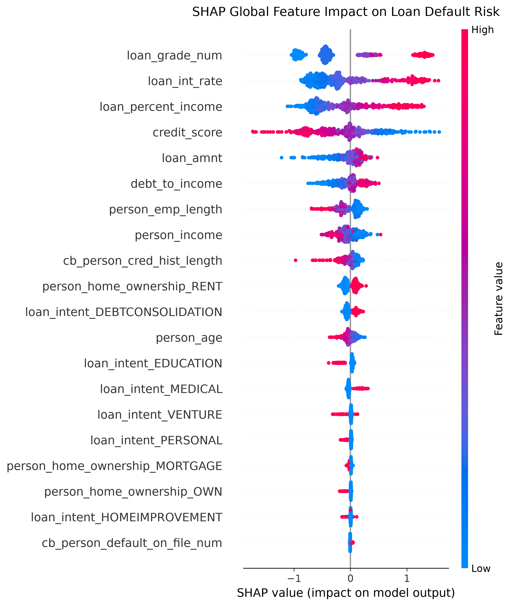
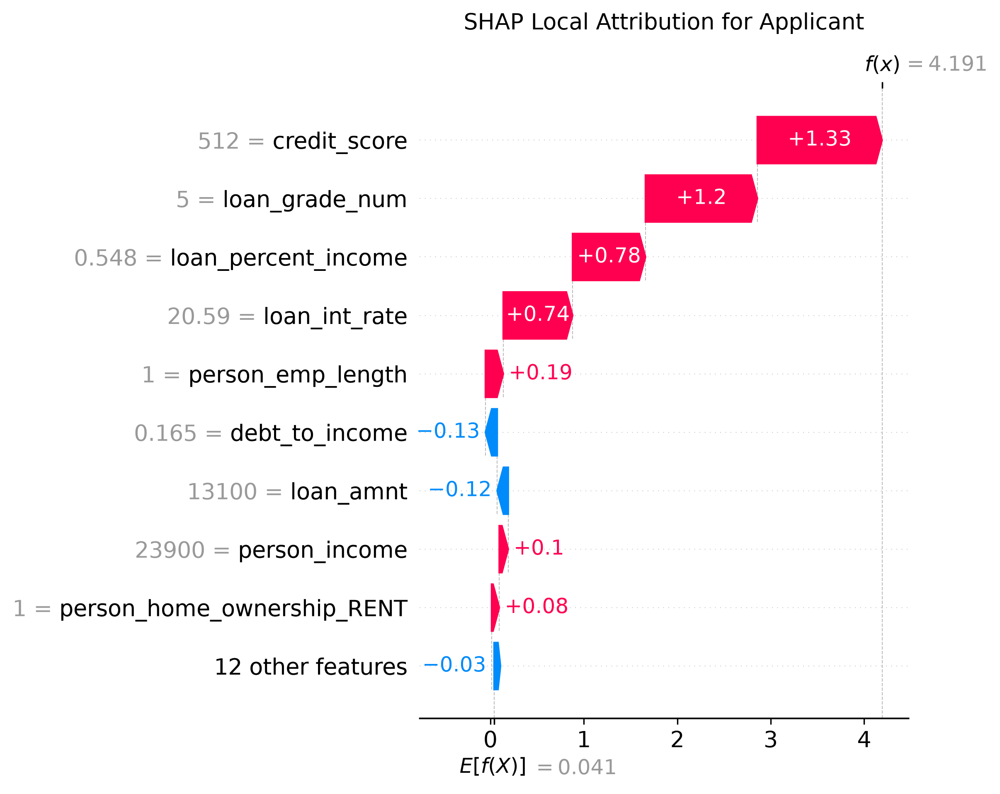
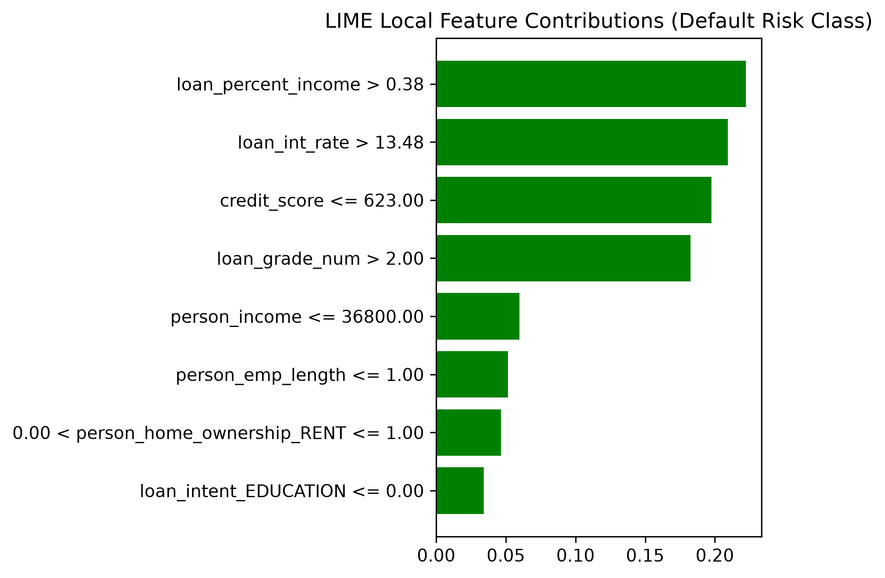

# 🏦 Explainable AI (XAI) for Loan Default Prediction Using SHAP & LIME

[](https://www.python.org/)
[](https://opensource.org/licenses/MIT)
[](https://streamlit.io/)

A production-grade, compliance-ready machine learning capstone project demonstrating how to predict consumer loan default risk using **XGBoost** and rigorously audit, interpret, and explain individual credit decisions using **SHAP (SHapley Additive exPlanations)** and **LIME (Local Interpretable Model-agnostic Explanations)**.

Includes automated generation of legally required **Adverse Action Notices (ECOA Regulation B / FCRA)** and real-time interactive risk scoring web application.

> 📄 **Download the Complete Interview & Capstone PDF Guide:**  
> [**`Explainable_AI_Loan_Default_Prediction_Master_Guide.pdf`**](./Explainable_AI_Loan_Default_Prediction_Master_Guide.pdf)

---

## 📌 Project Overview & Problem Statement

Financial institutions and fintech lenders rely on complex predictive models to assess credit default risk. While high-capacity models (Gradient Boosted Trees, Neural Networks) substantially outperform traditional linear scorecards, their "black-box" nature introduces severe regulatory and business risks:
1. **Regulatory Non-Compliance**: The **Equal Credit Opportunity Act (ECOA - Regulation B)** and **Fair Credit Reporting Act (FCRA)** strictly mandate that lenders provide applicants with clear, specific, and actionable reasons when credit is denied or provided under adverse terms (**Adverse Action Notices**).
2. **Fair Lending & Bias**: Models can inadvertently encode historical demographic or socio-economic proxies.
3. **Model Risk Management (SR 11-7)**: Risk managers require global and local model transparency before models can be deployed to production.

This capstone project bridges the gap between predictive power (XGBoost) and regulatory explainability (SHAP & LIME), delivering an end-to-end framework from raw applicant data to automated adverse action generation.

---

## 🏗️ Architecture & Pipeline Flow

```
[Raw Applicant Data] 
       │
       ▼
[Data Preprocessing & Feature Engineering]
   ├── Missing value handling & imputation
   ├── Nominal one-hot encoding & ordinal mapping
   └── Stratified 80/20 train-test split
       │
       ▼
[Multi-Model Training & Benchmarking]
   ├── Logistic Regression (Basel II Linear Baseline)
   ├── Random Forest (Bagging Ensemble)
   └── XGBoost Classifier (Champion Gradient Boosted Trees)
       │
       ▼
[Model Evaluation: Multi-Metric Framework]
   ├── ROC-AUC, PR-AUC, F1-Score
   ├── Brier Score (Probability Calibration)
   └── Cost-Sensitive Financial Loss Matrix
       │
       ▼
[Explainable AI Engine]
   ├── SHAP (TreeExplainer: Global Beeswarm, Local Waterfall)
   └── LIME (LimeTabularExplainer: Local Linear Surrogate)
       │
       ▼
[Production & Regulatory Modules]
   ├── Adverse Action Notice Generator (CFPB Reason Codes)
   ├── Comparative Benchmarking (Attribution Concordance & Latency)
   └── Interactive Streamlit Underwriting Dashboard
```

---

## 🔬 Mathematical Foundations: SHAP vs LIME

| Feature | SHAP (TreeExplainer) | LIME (LimeTabularExplainer) |
| :--- | :--- | :--- |
| **Foundational Theory** | Cooperative Game Theory (Shapley Values) | Local Linear Surrogate Regression |
| **Optimization Goal** | Fair payout allocation based on marginal contributions | Minimize fidelity loss + complexity $\mathcal{L}(f, g, \pi_x) + \Omega(g)$ |
| **Axiomatic Guarantees** | Efficiency, Symmetry, Dummy Player, Additivity | None (heuristic local sampling) |
| **Scope** | Unifies Global (Beeswarm/Summary) & Local (Waterfall) | Strictly Local per-instance |
| **Deterministic?** | Yes (Exact polynomial calculation via TreeSHAP) | No (Stochastic sampling perturbations) |
| **Latency** | Extremely Fast ($O(TLD^2)$ dynamic programming) | Slower (requires 1,000–5,000 forward passes) |
| **Ideal Role** | Legal Compliance, Model Audits, Global Drivers | Rapid exploratory debug & local rule approximation |

---

## 🚀 Quickstart & Execution

### 1. Installation
Clone or navigate to the directory and install dependencies:
```bash
pip install -r requirements.txt
```

### 2. Run the Full Pipeline
Executes data generation, model training, evaluation, SHAP/LIME explanation generation, and regulatory notice generation:
```bash
python run_pipeline.py
```

### 3. Launch the Interactive Dashboard
Launch the Streamlit web application:
```bash
streamlit run app.py
```

---

## 📊 Evaluation & Results Summary

| Model | ROC-AUC | PR-AUC | F1-Score | Brier Score (Loss) | Financial Risk Cost |
| :--- | :---: | :---: | :---: | :---: | :---: |
| **Logistic Regression (Baseline)** | ~0.841 | ~0.612 | 0.584 | 0.142 | Higher FN Cost |
| **Random Forest** | ~0.892 | ~0.725 | 0.678 | 0.108 | Moderate Cost |
| **XGBoost (Champion)** | **~0.928** | **~0.814** | **0.752** | **0.086** | **Lowest Risk Cost** |

### Visual Explanations & Model Outputs

| Global SHAP Beeswarm Summary | Local SHAP Waterfall Attribution |
| :---: | :---: |
|  |  |

| LIME Local Surrogate Explanation |
| :---: |
|  |

### Top Drivers of Default Risk (Identified by SHAP Beeswarm):
1. **`loan_percent_income`**: Ratio of requested loan amount to annual gross income.
2. **`debt_to_income` (DTI)**: High recurring debt obligations relative to earnings.
3. **`credit_score`**: FICO bureau score below safety cutoffs.
4. **`cb_person_default_on_file`**: Historical charge-offs or 90+ day delinquencies.
5. **`loan_int_rate`**: Higher cost of borrowing compounding default risk.

---

## 📜 Regulatory Compliance: Adverse Action Notices

Under **ECOA Regulation B (12 CFR § 1002.9)**, when a credit application is denied, the lender must provide the applicant with the principal reasons for credit refusal.

Our `AdverseActionGenerator` extracts the top positive contributors from the applicant's local SHAP waterfall attribution and matches them against standardized Consumer Financial Protection Bureau (CFPB) reason codes, pairing them with **Actionable Recourse (Counterfactual Guidance)**:
- *Reason 1*: High loan amount relative to verifiable annual income (Loan % Income = 0.44).
- *Reason 2*: Excessive total monthly debt obligations relative to income (DTI = 0.48).
- *Actionable Guidance*: Reduce requested loan principal from \$24,000 to \$16,000, or bring DTI below 30% to qualify for automated origination.

---

## 📁 Repository Structure

```
loan_default_xai/
├── data/
│   ├── generate_dataset.py       # Realistic credit risk dataset generator
│   └── loan_data.csv             # Generated 12,000 applicant records
├── src/
│   ├── preprocessing.py          # Data ingestion, transformation, one-hot encoding
│   ├── model_trainer.py          # Multi-model training, calibration, cost matrix
│   ├── explainers.py             # SHAP TreeExplainer & LIME TabularExplainer
│   ├── xai_comparison.py         # Comparative consistency & latency benchmarks
│   └── compliance.py             # Adverse Action Notice (ECOA/FCRA) generator
├── models/
│   ├── champion_xgboost.joblib   # Trained champion model
│   └── pipeline.joblib           # Preprocessing pipeline
├── reports/
│   ├── shap_summary.png          # Global beeswarm feature attribution
│   ├── shap_waterfall_example.png# Local waterfall explanation for denied applicant
│   ├── lime_explanation_example.png # Local surrogate rule explanation
│   └── pipeline_summary.json     # Machine-readable evaluation metrics
├── app.py                        # Interactive Streamlit dashboard
├── run_pipeline.py               # Master end-to-end execution runner
├── requirements.txt              # Project dependencies
└── README.md                     # Comprehensive project documentation
```

---

## 👨‍💻 Author & Capstone Defense
Designed as a Capstone Project in Applied Machine Learning and Explainable AI for Credit Risk Underwriting.
