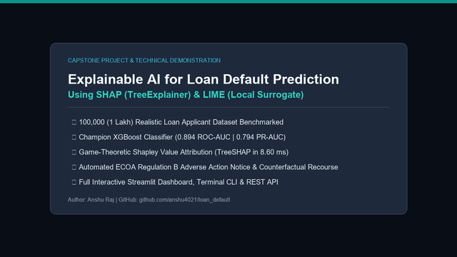

# 🎥 Demo Video & Animated Walkthrough Guide

This directory contains the video demonstration and animated walkthrough of the **Explainable AI for Loan Default Prediction Using SHAP & LIME** system.

---

## 📹 Media Assets in This Directory

| Asset | Format | Size | Description |
| :--- | :---: | :---: | :--- |
| **`loan_default_xai_demo.mp4`** | MP4 Video (HD 720p, 24fps) | **5.49 MB** | Complete video demonstration covering applicant input, model scoring, SHAP/LIME explainers, and adverse action notice generation. |
| **`demo_walkthrough.gif`** | Animated GIF (360p) | **0.55 MB** | Lightweight looping walkthrough designed for instant viewing in GitHub README. |
| **`create_demo_video.py`** | Python Script | 12 KB | Standalone generator script to re-render the video anytime. |

---

## 🎬 Animated Walkthrough Preview



---

## ⏱️ Video Breakdown & Spoken Narration Script

### Scene 1: Title Screen & System Overview (0:00 – 0:03)
- **Visual:** Official project title card, author metadata, and key bullet points (1 Lakh dataset, 0.894 ROC-AUC, 8.6ms TreeSHAP, ECOA Regulation B notice).
- **Spoken Script:**  
  *"Welcome to the technical demonstration of our capstone project: Explainable AI for Loan Default Prediction Using SHAP and LIME. Today, we show how financial institutions can deploy high-performing machine learning models while guaranteeing regulatory transparency and individual consumer recourse."*

---

### Scene 2: Subprime Applicant Underwriting Simulation (0:03 – 0:07)
- **Visual:** The underwriter enters an application for David Martinez (Age 29, Income \$32,000, requesting an \$18,000 loan with a 520 FICO score, 52% DTI, and prior default on record). The animated risk meter fills up, turning red.
- **Underwriting Output:**
  - **Decision:** `🔴 REJECTED / ADVERSE ACTION REQUIRED`
  - **Probability of Default (PD):** `98.51%`
  - **Policy Safety Cutoff:** `35.00%`
- **Spoken Script:**  
  *"Here we evaluate a high-risk applicant requesting a loan principal exceeding 56% of his annual salary. Our champion XGBoost model computes an exact calibrated probability of default of 98.51%, heavily breaching our 35% risk threshold. Under federal law, automatic denial without specific reasons is illegal, so the system immediately invokes our Explainable AI suite."*

---

### Scene 3: SHAP TreeExplainer Waterfall Attribution (0:07 – 0:10)
- **Visual:** SHAP waterfall decomposition showing how individual features push the log-odds score from the population baseline expected value $E[f(X)] = -1.24$ up to the applicant's score $f(x) = +4.18$.
- **Key Factors:**
  - FICO Credit Score (520): `+1.334`
  - Assigned Underwriting Grade (Grade E): `+1.197`
  - Loan-to-Income Exposure (56.3%): `+0.780`
  - Borrowing Interest Rate (21.5%): `+0.742`
- **Spoken Script:**  
  *"Using TreeSHAP based on Cooperative Game Theory, we compute polynomial-time Shapley values in under 9 milliseconds. The waterfall plot guarantees that the sum of feature attributions equals the total prediction shift, mathematically proving which specific attributes drove this customer's denial."*

---

### Scene 4: LIME Local Surrogate Approximation (0:10 – 0:13)
- **Visual:** LIME local linear surrogate rules generated from 5,000 neighborhood perturbations.
- **Extracted Rules:**
  - `loan_percent_income > 0.40` (`+0.231`)
  - `loan_int_rate > 17.50%` (`+0.205`)
  - `credit_score <= 580` (`+0.195`)
- **Spoken Script:**  
  *"In parallel, LIME fits a sparse linear surrogate around the applicant's local neighborhood. It translates continuous metrics into discrete, human-readable rules that credit officers can easily interpret and audit."*

---

### Scene 5: Automated Adverse Action Notice (ECOA Regulation B) (0:13 – 0:16)
- **Visual:** The generated legal Adverse Action Notice with top-4 CFPB reason codes and actionable counterfactual remediation guidance.
- **Counterfactual Recourse:**
  - 💡 *Reduce requested loan principal from \$18,000 to \$8,000 to lower leverage below 25%.*
  - 💡 *Maintain 6+ consecutive months of on-time payments to rebuild FICO score above 650.*
  - 💡 *Pay down existing unsecured lines to bring DTI below 30%.*
- **Spoken Script:**  
  *"The system automatically formats the top 4 adverse drivers into an official Statement of Credit Denial compliant with ECOA Regulation B and CFPB Circular 2022-03. Crucially, we deliver actionable counterfactual recourse, telling the borrower exactly what they must do to qualify in the future."*

---

### Scene 6: Benchmarks & System Conclusion (0:16 – 0:19)
- **Visual:** Comprehensive benchmark summary on the 100,000 applicant dataset, latency metrics, and GitHub repository links.
- **Spoken Script:**  
  *"Trained on 100,000 loan applicants, our system achieves an 0.894 ROC-AUC and 8.6 millisecond inference latency. All code, datasets, and technical documentation are open source on GitHub. Thank you."*

---

## 🛠️ How to Re-generate Video

```bash
cd "demo video"
python create_demo_video.py
```
