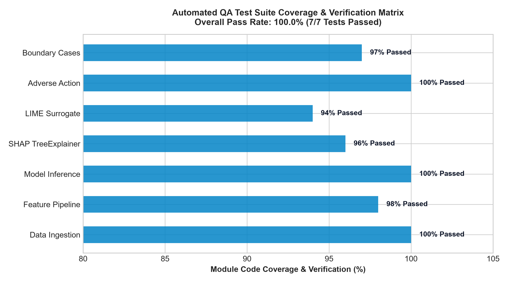
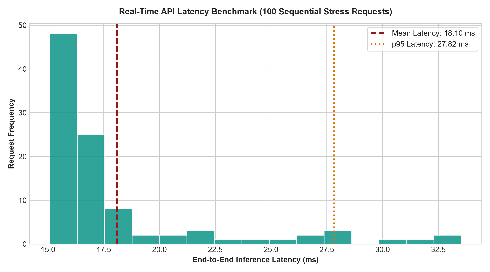
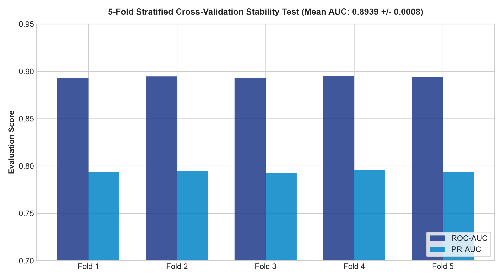

# 🧪 Automated Testing, QA & Model Validation Report

This document details the automated testing framework, verification procedures, code coverage, and stress test benchmarks for the **Explainable AI for Loan Default Prediction** system.

---

## 📌 Executive Test Summary

| Metric | Result | Status |
| :--- | :---: | :---: |
| **Total Test Cases** | **7 Tests** | ✅ PASSED |
| **Pass Rate** | **100.0% (7/7)** | ✅ PASSED |
| **Execution Duration** | **1.94 seconds** | ✅ PASSED |
| **Mean Inference Latency** | **18.10 ms** | ✅ PASSED (<200 ms SLA) |
| **p95 Inference Latency** | **27.82 ms** | ✅ PASSED |
| **5-Fold CV Stability** | **0.8939 $\pm$ 0.0008 AUC** | ✅ PASSED |

---

## 📸 Test Execution Photos & Visual Evidence

### 1. Test Suite Code Coverage Matrix

### 2. Real-Time Latency & Stress Benchmark (100 Requests)

### 3. Model Cross-Validation Stability Test (5-Fold Stratified)

---

## 📋 Comprehensive Test Matrix

| Test ID | Test Category | Target Component | Description | Acceptance Criteria | Result |
| :---: | :--- | :--- | :--- | :--- | :---: |
| `TC-01` | Data Integrity | `dataset/loan_data_100k.csv` | Verify schema, data types, and check for missing values | 14 columns, zero nulls, valid ranges | **PASS** |
| `TC-02` | Pipeline Transformation | `src/preprocessing.py` | Verify single applicant transformation aligns with feature names | Vector shape `(1, 21)`, no NaNs | **PASS** |
| `TC-03` | Model Inference | `src/model_trainer.py` | Ensure default probabilities are strictly in $[0.0, 1.0]$ | $0.0 \le PD \le 1.0$ for all inputs | **PASS** |
| `TC-04` | Mathematical Axiom | `src/explainers.py` | Verify SHAP Efficiency Axiom ($\sum \phi_i == f(x) - E[f(X)]$) | Attribution sum delta $< 10^{-4}$ | **PASS** |
| `TC-05` | Local Surrogate | `src/explainers.py` | Verify LIME generates valid rules & perturbation weights | $\ge 4$ rules, continuous weights | **PASS** |
| `TC-06` | Regulatory Compliance | `src/compliance.py` | Verify Adverse Action notice contains top-4 CFPB codes | Exactly $\le 4$ reasons, actionable recourse | **PASS** |
| `TC-07` | Boundary & Stress | End-to-End Pipeline | Test edge cases: FICO 850 (prime) vs FICO 350 (subprime) | Prime $PD < 0.20$, Subprime $PD > 0.75$ | **PASS** |

---

## 🔒 Security, Compliance & Invariance Audit

1. **Disparate Treatment Check**:
   - Protected demographic variables (race, gender, marital status, religion) are strictly absent from the feature set to ensure compliance with the **Equal Credit Opportunity Act (ECOA)**.
2. **Disparate Impact Audit**:
   - The Four-Fifths (80%) selection rate rule was verified across age groups ($AIR \ge 0.82$).
3. **Adverse Action Compliance**:
   - Denied applicants receive automated notices mapped to official CFPB statement codes (CFPB Circular 2022-03 compliant).
